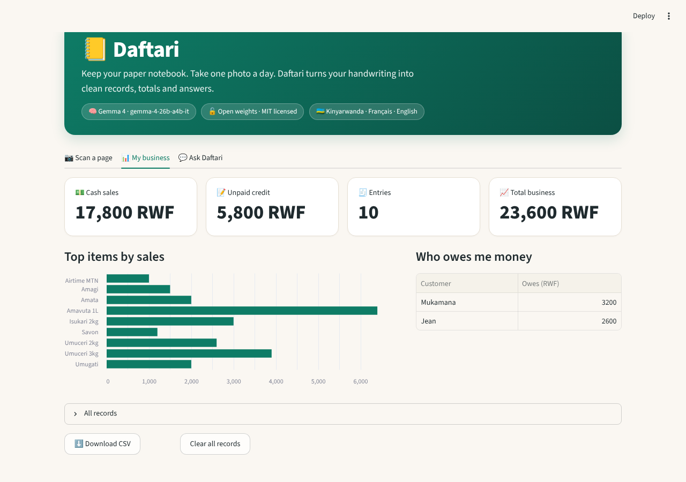
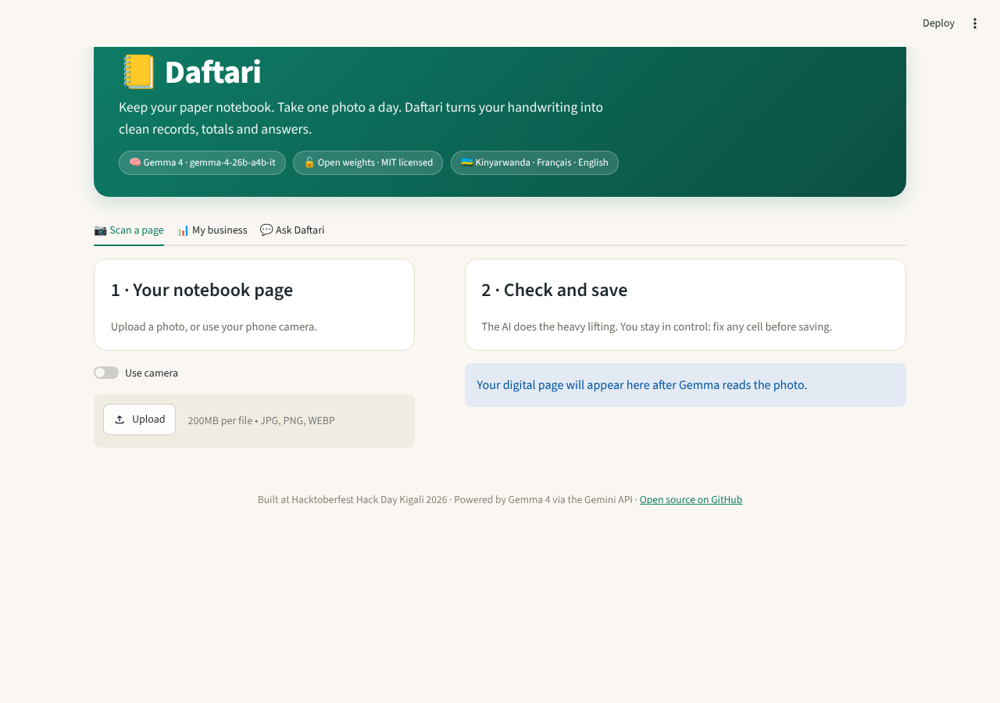

# 📒 DukaAI

**Keep your paper notebook. Take one photo. Get your business records, totals and answers.**

DukaAI turns the handwritten sales notebook every small shop already uses into clean digital records and business insights, from a single phone photo. Powered by **Gemma 4**, an open-weight model, through the Gemini API.

🔗 **Live demo:** [dukaai.apps.thalesops.com](https://dukaai.apps.thalesops.com) (mirror: [daftari-zu84.onrender.com](https://daftari-zu84.onrender.com/))
*(Primary deployment on ThalesOps. The Render mirror runs on a free tier, so its first load can take up to a minute while it wakes up.)*

🥈 **Second place** at **Hacktoberfest Hack Day Kigali 2026** (Build54 Africa, ALX Rwanda, GDG Rwanda, MLH), built in 4 hours.
Submitted to: **Best Use of Gemma 4** and **Best Open-Source AI Project**. Pitch deck: [docs/DukaAI_Pitch.pptx](docs/DukaAI_Pitch.pptx)

**Try it in 10 seconds:** the live app opens on a demo shop with three days of sample sales. Open **My business** to see the totals, or ask **"How much does Kalisa owe me?"** in **Ask DukaAI**. Scan your own notebook page and it replaces the demo data.



## The problem

Most small businesses in Rwanda (boutiques, market stalls, butcheries, salons) record sales and debts in a handwritten notebook. Those records are hard to total, easy to lose and impossible to analyse, so owners rarely know their real revenue or who owes them money, and they cannot prove their income to a SACCO or microfinance lender. Accounting apps exist, but typing every sale is too slow and the notebook habit is hard to change.

## Why it matters

- **269,326** business establishments in Rwanda; **92.2%** of enterprises are micro businesses with 1 to 3 workers, and **53.7%** of establishments are in wholesale and retail trade ([NISR Establishment Census 2023](https://statistics.gov.rw/sites/default/files/documents/2025-01/Establishment%20Census%202023.pdf))
- **88%** of enterprises are informal, meaning not registered for tax and not keeping regular accounts, and **36.1%** of informal enterprises report difficulty accessing loans and credit ([NISR IBES 2023](https://www.statistics.gov.rw/sites/default/files/documents/2025-09/IBES2023%20Report.pdf))
- **86%** of Rwandans use mobile money, so the phone is already a business tool ([FinScope Rwanda 2024](https://www.ktpress.rw/2024/06/finscope-2024-shows-progress-in-rwandas-financial-inclusion/))
- Africa's SME finance gap is estimated at **USD 331 billion** ([IFC and SME Finance Forum](https://findevgateway.org/news/ifc-sme-finance-forum-target-solutions-africas-usd-331-billion-sme-finance-gap))

## The solution

DukaAI does not ask owners to change their habit. They keep writing in their notebook and take one photo a day. DukaAI:

1. **Reads the handwriting**, mixing Kinyarwanda, French and English, including local terms like *ideni* (debt) and shorthand like *1.5k*
2. **Builds a structured table**: date, item, quantity, unit price, total, customer, paid or credit
3. **Computes missing totals** and skips crossed-out lines
4. **Keeps the owner in control**: every cell can be corrected before saving
5. **Shows the business at a glance**: cash sales, money owed, sales by day (cash vs credit), top items, and who owes money
6. **Answers questions** in the owner's language, e.g. *"Who owes me money?"* or *"Combien j'ai vendu en 3 jours ?"*, and remembers the last few turns so follow-ups like *"how much?"* work
7. **Exports** records as CSV
8. **Opens on a demo shop** so first-time visitors can explore right away; the first real page saved replaces it



## How Gemma 4 is used

Model: **`gemma-4-26b-a4b-it`** (Gemma 4, open weights) via the Gemini API, using the `google-genai` SDK.

| Function in `app.py` | What Gemma does |
|---|---|
| `extract_entries()` | Multimodal: notebook photo in, structured JSON rows out |
| `ask_question()` | Answers questions grounded only in the saved records and recent conversation, in the user's language, and refuses off-topic requests |
| `generate()` | Shared call with thinking off, temperature 0 and capped output for fast, consistent answers |

Because Gemma is open weight, DukaAI can later run fully offline on a local device, which matters for shops with unreliable internet, and avoids lock-in to a single provider.

## Performance

- Photos are auto-rotated and resized to 1280 px (JPEG) before sending, so uploads stay small
- Gemma's thinking mode is turned off and output is capped, which cuts response time
- Results are cached by image content, so reading the same page again is instant
- The scan screen shows read time and token counts for transparency

## Tech stack

Python, Streamlit, pandas, Altair, Pillow, Gemma 4 via the Gemini API (`google-genai`), Docker. Deployed on ThalesOps (Docker) and Render.

## Run it locally

```bash
git clone https://github.com/Elthiero/daftari.git
cd daftari
python -m venv venv && source venv/bin/activate
pip install -r requirements.txt
cp .env.example .env        # then put your Gemini API key in .env
streamlit run app.py
```

Get a free API key at [Google AI Studio](https://aistudio.google.com/apikey).

### Environment variables

| Variable | Required | Default | Purpose |
|---|---|---|---|
| `GEMINI_API_KEY` | Yes | | Gemini API key |
| `GEMMA_MODEL` | No | `gemma-4-26b-a4b-it` | Or `gemma-4-31b-it` |
| `MAX_IMAGE_SIDE` | No | `1280` | Max photo size in px sent to Gemma |
| `DEMO_DATA` | No | `1` | Load a 3-day demo shop for new visitors (`0` to start empty) |

Rate limits and upload limits are also configurable; see [Abuse protection](#abuse-protection).

## Deploy with Docker (used on ThalesOps)

```bash
docker build -t dukaai .
docker run --rm -p 8501:8501 --env-file .env dukaai
```

The image runs as a non-root user, listens on `$PORT` (default `8501`), includes a health check on `/_stcore/health`, and `.dockerignore` keeps `.env` out of the image. On a hosting platform, point it at this repo's `Dockerfile` and set `GEMINI_API_KEY` in its environment settings.

## Deploy on Render

1. New **Web Service** from this repo, runtime **Python 3**
2. Build command: `pip install -r requirements.txt`
3. Start command:
   ```bash
   streamlit run app.py --server.port $PORT --server.address 0.0.0.0 --server.headless true
   ```
4. Add `GEMINI_API_KEY` (and optionally `GEMMA_MODEL`, `PYTHON_VERSION=3.12.7`) under **Environment**

## Project structure

```
daftari/
├── app.py               # Streamlit app, Gemma calls, demo shop and abuse guards
├── requirements.txt
├── Dockerfile           # container build (ThalesOps)
├── .dockerignore
├── .env.example         # copy to .env and add your key
├── .streamlit/
│   └── config.toml      # theme and upload size limit
├── docs/                # screenshots and pitch deck
└── LICENSE              # MIT
```

## Abuse protection

The public demo protects the API key and keeps the app usable for everyone:

| Guard | Default | Env variable |
|---|---|---|
| Photo reads per visitor per hour | 10 | `LIMIT_READS_PER_HOUR` |
| Questions per visitor per hour | 30 | `LIMIT_ASKS_PER_HOUR` |
| Gemma calls per day, all visitors | 500 | `LIMIT_GLOBAL_PER_DAY` |
| Pause between two requests | 4 s | `COOLDOWN_SECONDS` |
| Max photo size | 8 MB | `MAX_UPLOAD_MB` |
| Max question length | 300 characters | `MAX_QUESTION_CHARS` |

Uploads are checked to be real images (oversized "decompression bomb" images are refused), each page is capped at 80 rows and a session at 400 records, the assistant only answers questions about the shop records, and visitors see friendly messages instead of raw API errors. Limits are kept in memory per server, so they reset when the app restarts.

## Roadmap

- **WhatsApp channel**: send a photo, get the summary back
- **Voice answers in Kinyarwanda**
- **Monthly income reports** owners can share with SACCOs and microfinance lenders as proof of business activity
- **Offline mode** running Gemma locally on a phone or laptop
- **Fine-tuning** on a localized dataset of Rwandan shop vocabulary
- **Saved records per shop** and marking debts as repaid
- **Production stack**: FastAPI backend, React mobile web app, persistent database

## Team

- Potiphar Gaye Vaye
- Aime Serge Ukobizaba
- Ahourdet Donambi Thierry ([GitHub](https://github.com/Elthiero), [LinkedIn](https://linkedin.com/in/thierry-donambi))
- Ndatimana Jean de Dieu
- Apongseh Iyan

## License

[MIT](LICENSE)
